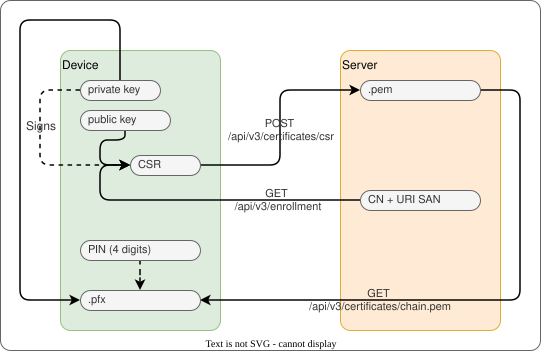

# User certificates



Each approved User gets one client certificate.
The client generates the key pair, and the server never holds a private key.

## Flow

1. `POST /api/v3/enrollment` redeems an invite and returns a JWT.
2. An administrator checks the approval code and sets `approvedAt`.
3. `GET /api/v3/enrollment` returns `certificateCommonName` and `certificateUri` after approval.
4. The client sends a CSR for that identity with `POST /api/v3/certificates/csr`.
5. The operator consumes the approval and creates the CertificateRequest `user-<resource-name>`
   in `opendefence-public-certs`. cert-manager signs it with `public-issuer`.
6. `GET /api/v3/certificates/chain.pem` returns the leaf certificate and the CA.

## API

| Route                                | Status code | Meaning                               |
| ------------------------------------ | ----------- | ------------------------------------- |
| `POST /api/v3/certificates/csr`      | `202`       | CSR Stored but not processed          |
|                                      | `400`       | Invalid CSR                           |
|                                      | `401`       | No valid JWT                          |
|                                      | `403`       | Not approved                          |
|                                      | `409`       | Approval used or User changed (retry) |
| `GET /api/v3/certificates/chain.pem` | `200`       | PEM chain                             |
|                                      | `401`       | No valid JWT                          |
|                                      | `409`       | Not ready                             |

The body is `{"csr": "<PEM>"}`. A valid CSR has an ECDSA P-256 key, a valid signature, the subject
`CN=<certificateCommonName>`, and one extension: a subjectAltName with the URI `<certificateUri>`.
The limit is 8192 characters.

## Approval

`approvedAt` authorizes the first certificate.
`certificateApprovedAt` authorizes exactly one replacement. It must be later than the consumed approval.
Each approval signs one CSR. After that, the API refuses CSRs until a fresh approval.
A fresh `certificateApprovedAt` withdraws the current certificate at once.
Revoking or unapproving a User withdraws the certificate and deletes the CertificateRequest.
Certificates do not renew.

## Status

The `CertificateReady` condition reason associated with a `User` shows progress:

| Status                       | Meaning                                                             |
| ---------------------------- | ------------------------------------------------------------------- |
| `PendingApproval`            | The User is not approved.                                           |
| `Revoked`                    | The User is revoked.                                                |
| `AwaitingRequest`            | The approval is fresh. The operator waits for a CSR.                |
| `InvalidRequest`             | The stored CSR is not valid. The message tells why. Send a new CSR. |
| `Issuing`                    | cert-manager has not signed the request yet.                        |
| `Issued`                     | The certificate is verified and accepted.                           |
| `InvalidCertificate`         | The signed certificate failed verification.                         |
| `CertificateOutsideValidity` | The certificate is expired or not yet valid.                        |
| `FreshApprovalRequired`      | The approval is consumed and the CertificateRequest is missing.     |

## Identity

The URI SAN is `urn:uuid:<User UID>`. Integrations use it as the identity.
The CN is `<CORE_DEPLOYMENT>#<tag>`, for example `local-dev#1a2b3c4d`. The tag is the first eight
hexadecimal digits of SHA-256 over the UID. The CN is a label designed to be short. Callsign changes
keep the certificate. A new User UID needs a new certificate.

## Accepted credentials

The operator sets `platform.opendefence.fi/accepted-credentials` on the User to `{"version":1,"accepted":[...]}`.
Each record has `fingerprintSha256` (SHA-256 of the leaf DER), `serial` (lowercase hex),
`issuerId` (`sha256:` and SHA-256 of the CA public key SPKI), `notBefore`, and `notAfter` (RFC 3339).
Integrations accept only a certificate with a listed fingerprint, inside its validity window.
Integrations remove access when the record is removed. A missing or malformed record grants no access.
`platform.opendefence.fi/certificate-approval` records the consumed approval.

## Settings

The default duration is `2880h` (120 days). Override it in a Kustomize overlay:

```yaml
apiVersion: kustomize.config.k8s.io/v1beta1
kind: Kustomization
resources:
  - ../../manifests/operator
configMapGenerator:
  - name: core-operator-config
    namespace: opendefence-system
    behavior: merge
    literals:
      - CORE_OPERATOR_USER_CERTIFICATE_DURATION=2880h
```
