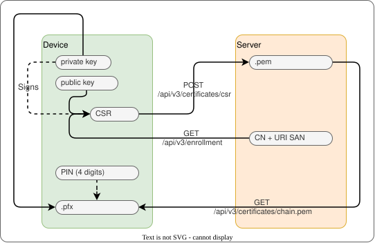

# User certificates



Each approved User gets one client certificate.
The client generates the key pair, and the server never holds a private key.

## Flow

1. `POST /api/v3/enrollment` redeems an invite and returns a JWT.
2. An administrator checks the approval code and sets `approvedAt`.
3. `GET /api/v3/enrollment` returns `certificateCommonName` and `certificateUri` after approval.
4. The client sends a CSR for that identity with `POST /api/v3/certificates/csr`.
5. The operator consumes the approval and creates the CertificateRequest `user-<resource-name>`
   in `opendefence-client-certs`. cert-manager signs it with `client-issuer`.
6. `GET /api/v3/certificates/chain.pem` returns the leaf certificate and the CA.
7. `GET https://app.<domain>/api/v3/users/me` with the client certificate returns the caller.

## API

| Route                                | Status code | Meaning                               |
| ------------------------------------ | ----------- | ------------------------------------- |
| `POST /api/v3/certificates/csr`      | `202`       | CSR Stored but not processed          |
|                                      | `400`       | Invalid CSR                           |
|                                      | `401`       | No valid JWT                          |
|                                      | `403`       | Not approved                          |
|                                      | `409`       | Approval used or User changed (retry) |
| `GET /api/v3/certificates/chain.pem` | `200`       | PEM chain                             |
|                                      | `401`       | No valid JWT                          |
|                                      | `409`       | Not ready                             |
| `POST /api/v3/certificates/ocsp`     | `200`       | DER OCSP response                     |
| `GET /api/v3/certificates/ocsp/...`  | `200`       | DER OCSP response                     |

The body is `{"csr": "<PEM>"}`. A valid CSR has an ECDSA P-256 key, a valid signature, the subject
`CN=<certificateCommonName>`, and one extension: a subjectAltName with the URI `<certificateUri>`.
The limit is 8192 characters.

## Client certificate authentication

`app.<domain>` requires a client certificate signed by `client-issuer`. Traefik verifies it
with the TLSOption `core-mtls` against the Secret `client-ca` in `traefik-system`.
Base creates the issuer and the Secret with every `issuer.type`. Server certificates come from `public-issuer`.

The IngressRoute `core-api-mtls` applies the middlewares in this order:

1. `strip-identity-headers` removes identity headers that the client sends.
2. `pass-client-cert` sets `X-Forwarded-Tls-Client-Cert` to the verified chain.
3. `hsts` sets HSTS.

The API reads the URI SAN from the leaf certificate and finds the User with that UID.
The API accepts the certificate only if its serial and fingerprint are in the accepted credentials,
inside the validity window, and the User is not revoked. Otherwise the API returns `401`.
`<domain>` does not ask for a client certificate. Enrollment browsers do not see a certificate prompt.

The API trusts `X-Forwarded-Tls-Client-Cert` only because Traefik sets it after the TLS handshake.
The Linkerd policy in `manifests/api/server.yaml` lets only Traefik's ServiceAccount call `core-api`.
Other callers get `403`. The kubelet probes `/healthz` and `/readyz` stay allowed.
`kubectl port-forward` does not go through the policy. It needs cluster RBAC, so use it only for development.

## OCSP

`https://<domain>/api/v3/certificates/ocsp` is an OCSP responder (RFC 6960, RFC 5019) for `client-issuer`.
It needs no authentication.
Send the DER request in a `POST` body, or as URL-encoded base64 after the path in a `GET`.

The responder gives these answers:

| Answer             | When                                                                                                                          |
| ------------------ | ----------------------------------------------------------------------------------------------------------------------------- |
| `good`             | The serial is in the accepted credentials of a User that is not revoked, inside its validity window.                          |
| `good`             | The serial is the serial of the responder certificate.                                                                        |
| `revoked`          | Any other serial of `client-issuer`.                                                                                          |
| `unauthorized`     | The request is for a different CA, or its hash algorithm is not SHA-1 or SHA-256.                                             |
| `malformedRequest` | The request is empty, larger than 10000 bytes, not valid, for more than one certificate, or has a nonce longer than 32 bytes. |
| `internalError`    | The User list or the responder certificate is not available.                                                                  |

The responder does not answer `unknown`. Revocation removes the accepted credential, so a revoked
serial and a serial that was never issued look the same. Both get the RFC 6960 form for a
certificate that was not issued: `revocationTime` 1970-01-01, reason `certificateHold`, and the
extended revoke extension.

A response is valid for 10 minutes. A response without a nonce has cache headers for that time.
A response with a nonce has `Cache-Control: no-store`.

The responder signs with a delegated responder certificate, not with the CA key.
The Certificate `core-api-ocsp` in `opendefence-system` gets it from `client-issuer` with the
`ocsp signing` usage. cert-manager renews it, and the API reads the new files on the next request.

User certificates do not contain an OCSP URL. Configure the URL in each consumer.
Configure each consumer to deny the connection when the OCSP check fails or gives no answer,
for example Keycloak `x509-cert-auth.ocsp-fail-open: "false"`.
The API does not use OCSP. It checks the accepted credentials directly.

## Approval

`approvedAt` authorizes the first certificate.
`certificateApprovedAt` authorizes exactly one replacement. It must be later than the consumed approval.
Each approval signs one CSR. After that, the API refuses CSRs until a fresh approval.
A fresh `certificateApprovedAt` withdraws the current certificate at once.
Revoking or unapproving a User withdraws the certificate and deletes the CertificateRequest.
Certificates do not renew.

## Status

The `CertificateReady` condition reason associated with a `User` shows progress:

| Status                       | Meaning                                                             |
| ---------------------------- | ------------------------------------------------------------------- |
| `PendingApproval`            | The User is not approved.                                           |
| `Revoked`                    | The User is revoked.                                                |
| `AwaitingRequest`            | The approval is fresh. The operator waits for a CSR.                |
| `InvalidRequest`             | The stored CSR is not valid. The message tells why. Send a new CSR. |
| `Issuing`                    | cert-manager has not signed the request yet.                        |
| `Issued`                     | The certificate is verified and accepted.                           |
| `InvalidCertificate`         | The signed certificate failed verification.                         |
| `CertificateOutsideValidity` | The certificate is expired or not yet valid.                        |
| `FreshApprovalRequired`      | The approval is consumed and the CertificateRequest is missing.     |

## Identity

The URI SAN is `urn:uuid:<User UID>`. Integrations use it as the identity.
The CN is `<CORE_DEPLOYMENT>#<tag>`, for example `local-dev#1a2b3c4d`. The tag is the first eight
hexadecimal digits of SHA-256 over the UID. The CN is a label designed to be short. Callsign changes
keep the certificate. A new User UID needs a new certificate.

## Accepted credentials

The operator sets `platform.opendefence.fi/accepted-credentials` on the User to `{"version":1,"accepted":[...]}`.
Each record has `fingerprintSha256` (SHA-256 of the leaf DER), `serial` (lowercase hex),
`issuerId` (`sha256:` and SHA-256 of the CA public key SPKI), `notBefore`, and `notAfter` (RFC 3339).
Integrations accept only a certificate with a listed fingerprint, inside its validity window.
Integrations remove access when the record is removed. A missing or malformed record grants no access.
`platform.opendefence.fi/certificate-approval` records the consumed approval.

## Settings

The default duration is `2880h` (120 days). Override it in a Kustomize overlay:

```yaml
apiVersion: kustomize.config.k8s.io/v1beta1
kind: Kustomization
resources:
  - ../../manifests/operator
configMapGenerator:
  - name: core-operator-config
    namespace: opendefence-system
    behavior: merge
    literals:
      - CORE_OPERATOR_USER_CERTIFICATE_DURATION=2880h
```
